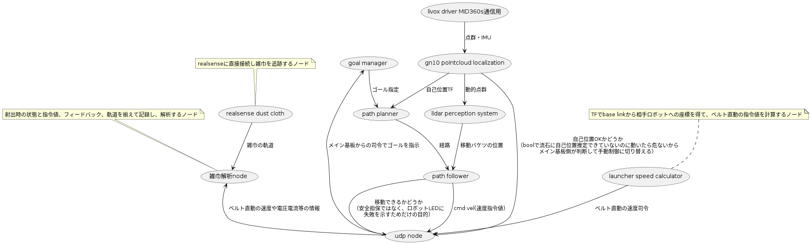
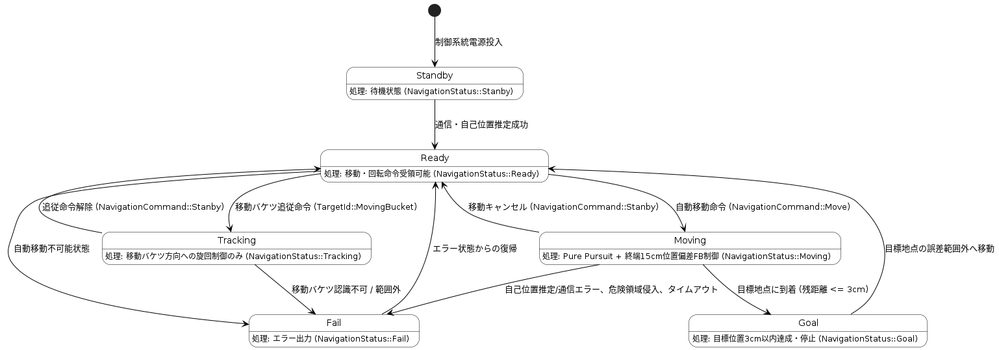

# gn10-navigation システム仕様書・実装方針

## 1. 概要・基本方針

本文書は、NHK高専ロボコン2026等の自動走行要求を満たすナビゲーションパッケージ「gn10-navigation」の仕様、実装方針、インターフェースおよび状態遷移を定義するものである。

### 単一責任の原則（KISS原則）

各ノードの責務を以下のように独立させ、データの流れを一方向（DAG構造）に保つ。

* target_manager_node: メインマイコンからの指示に応じた最適な投擲・目標座標の管理と発行。
* costmap_generator_node: フィールド定義に基づく障害物レイアウトおよび波及コスト付き地図データ（OccupancyGrid）の生成。
* path_planner_node: コストマップと目標姿勢に基づく格子経路（Path）の算定。
* path_follower_node: ナビゲーション状態（NavigationStatus）の管理およびPure Pursuitと位置偏差フィードバックによる運動制御。

ノード間での処理の重複（例: Planner側での追従制御用平滑化・最適化、Costmap側での可変減衰インフレーション等）を排除し、処理の因果関係を単純に保つ。

### 可読性と見通しの確保

複雑な山登り最適化やB-spline平滑化、多フェーズS字制御などの過度なアルゴリズムを廃し、Pure Pursuit、P制御、8方向A*標準実装、Multi-Source BFS等の物理的意味が明確なコード骨格を採用する。

### 型安全とROS 2標準の遵守

OccupancyGrid（int8_t）の出力時は、通常領域を0〜99、致死・不可侵領域を100としてエンコードし、符号付き型へのキャストによる負数オーバーフローを防止する。メインマイコン等との通信に使用するEnum値はstd_msgs/msg/UInt8型に準拠させる。

---

## 2. システムアーキテクチャ

システム全体のデータフロー、ノード構成、および拡張機能連携を以下に示す。


[plantuml形式で記載した画像のソース](automation/node.pu)



---

## 3. 通信名・型・Enum定義

### 3.1 ROS 2 トピック・サービス仕様

| 通信名 | 種別 | 型 / フレーム | 発行元 | 受信元 | 概要 |
| --- | --- | --- | --- | --- | --- |
| /robot/navigation_command | Topic | std_msgs/msg/UInt8 | udp_node | TargetMgr / Follower | ナビゲーション動作命令 |
| /robot/target_id | Topic | std_msgs/msg/UInt8 | udp_node | TargetMgr / Follower | 目的地・追従対象ID |
| /robot/operation/navigation_status | Topic | std_msgs/msg/UInt8 | PathFollower | udp_node | ナビゲーション現在状態 |
| /robot/operation/cmd_vel | Topic | geometry_msgs/msg/Twist | PathFollower | udp_node | 機体ローカル座標系速度指示値 |
| /costmap | Topic | nav_msgs/msg/OccupancyGrid | CostmapGen | PathPlanner | 障害物コスト・波及勾配付きコストマップ |
| /goal_pose | Topic | geometry_msgs/msg/PoseStamped | TargetMgr | PathPlanner | 投擲ポイント（目標姿勢） |
| /planned_path | Topic | nav_msgs/msg/Path | PathPlanner | PathFollower | A*生成経路 |
| /target_manager/update_point | Service | Custom Service | VSCode Ext | TargetManager | 投擲ポイント（座標・角度・メモ）のメモリ更新 |
| /target_manager/save_points | Service | std_srvs/srv/Trigger | VSCode Ext | TargetManager | メモリ上の座標データをYAMLへ書き出し |
| /debug/lookahead_point | Topic | visualization_msgs/msg/Marker | PathFollower | RViz2 (Debug) | Pure Pursuit 注視点可視化 |
| map -> base_link | TF | TransformStamped | Localizer | Planner / Follower | 機体現在位置・姿勢 |
| map -> bucket_bottom | TF | TransformStamped | Perception | PathFollower | 移動バケツ目標姿勢 |

### 3.2 列挙型定義（std_msgs/msg/UInt8）

```cpp
enum class TargetId : uint8_t {
    StartZone    = 0,
    FixedBucket1 = 1,
    FixedBucket2 = 2,
    FixedBucket3 = 3,
    Desk1        = 4,
    Desk2        = 5,
    Flag         = 6,
    MovingBucket = 7
};

enum class NavigationStatus : uint8_t {
    Stanby   = 0,
    Ready    = 1,
    Moving   = 2,
    Tracking = 3,
    Goal     = 4,
    Fail     = 5
};

enum class NavigationCommand : uint8_t {
    Sleep  = 0,
    Stanby = 1,
    Move   = 2
};

```

---

## 4. 各ノードの仕様詳細およびアルゴリズム

### 4.1 TargetManagerNode (target_manager_node)

* 責務: メインマイコンからの/robot/target_idおよび/robot/navigation_commandを受信し、該当ターゲットに対応する最適投擲ポイント座標（/goal_pose）を選択してパブリッシュする。
* 運用・保存機構:
* 座標データはconfig/shooting_points.yamlからロードする。
* VSCode Extension等からROS 2サービス通信（/target_manager/update_point）でメモリ内データを書き換え、/target_manager/save_pointsが要求された段階でYAMLファイルへ書き出す。
* YAMLファイル書き出しと連携し、VSCode拡張機能側でgit commitを発行することで変更履歴を管理する。


### 4.2 CostmapGeneratorNode (costmap_generator_node)

* 責務: フィールド定義ファイル（nhk2026_map.json）から障害物オブジェクトを読み込み、ロボット半径および波及マージンに基づくコストマップを作成・配信する。
* アルゴリズム（計算量削減と波及処理）:
* 障害物ごとに基準コストを配置する（絶対不可侵: 254、仕切り板: 200、外壁: 120）。
* 障害物セルをスタート地点とするMulti-Source BFS（幅優先探索）を適用し、距離に応じたコスト波及（インフレーション勾配）を計算する。全セル直積ループを排除し、計算量をO(W × H)に抑える。
* ロボット半径内部（d <= robot_radius）は一律コスト254とする。
* 波及マージン領域（robot_radius < d <= robot_radius + margin）は以下の線形減衰を適用する。

$$C(d) = C_{\text{base}} \times \left(1.0 - \frac{d - r_{\text{robot}}}{M}\right)$$


* 送信時は、コスト254のセルを100に、それ以外の波及コスト（0〜253）を0〜99の範囲にスケール変換してOccupancyGrid（int8_t）のdata配列へ格納する。


### 4.3 PathPlannerNode (path_planner_node)

* 責務: /costmap と /goal_pose を受信し、最短かつ低コストな離散格子経路（/planned_path）を生成する。
* アルゴリズム:
* 波及コストに応じたペナルティを適用した8方向A*探索を実施する。

$$\text{Cost}_{\text{step}} = \text{StepLength} + \text{CostmapValue} \times k_{\text{penalty}}$$


* 探索された格子点列はB-spline等の重厚な平滑化・局所最適化を行わず、そのままワールド座標に変換して/planned_path（nav_msgs/msg/Path）として発行する。


### 4.4 PathFollowerNode (path_follower_node)

* 責務: ナビゲーション状態の管理、/planned_path への運動追従、および3cm以下の停止精度を達成する位置偏差フィードバック制御を実行する。
* 追従および停止アルゴリズム:
* 通常追従区間（目標残距離 d_goal >= 0.15 m）:
Lookahead距離（min_lookahead）先の経路点に対するPure Pursuitにより並進速度ベクトルを算定する。
* 終端位置偏差FB区間（0.03 m < d_goal < 0.15 m）:
目標位置への残距離ベクトルに基づく比例制御へ移行し、下限クランプ速度（0.05 m/s）を適用して確実に目標へ接近させる。

$$v_{\text{creep}} = \max(0.05, d_{\text{goal}} \times K_p)$$


* 完全停止区間（d_goal <= 0.03 m）:
目標停止精度3cm以内を達成したと判断し、速度指示値をゼロ化（vx=0, vy=0, wz=0）してNavigationStatus::Goalを出力する。
* Trackingモード（TargetId::MovingBucket かつ NavigationCommand::Move 時）:
並進移動を行わず（vx=0, vy=0）、TF（map -> bucket_bottom）の方向へ向ける旋回P制御（wz）のみを実行し、NavigationStatus::Trackingを出力する。


---

## 5. ナビゲーション状態遷移仕様

PathFollowerNodeが管理する状態遷移図を以下に示す。


[画像のソース](automation/navigation_state.pu)



---

## 6. パラメータ仕様

| ノード名 | パラメータ名 | 型 | 初期値 | 単位 | 概要 |
| --- | --- | --- | --- | --- | --- |
| costmap_generator_node | resolution | double | 0.05 | m/cell | グリッド解像度 |
|  | map_bounds.min_x / max_x | double | -6.0 / 6.0 | m | マップX軸限界 |
|  | map_bounds.min_y / max_y | double | -6.5 / 6.5 | m | マップY軸限界 |
|  | inflation.robot_radius | double | 0.35 | m | ロボット物理半径（不可侵幅） |
|  | inflation.margin | double | 0.50 | m | コスト波及マージン幅 |
| target_manager_node | yaml_file_path | string | "config/shooting_points.yaml" | - | 投擲ポイント定義ファイルパス |
| path_planner_node | map_configs.map_frame | string | "map" | - | マップフレーム名 |
|  | map_configs.base_frame | string | "base_link" | - | ロボット基準フレーム名 |
|  | a_star.planning_cost | double | 3.0 | - | 波及コストに対するA*ペナルティ倍率 |
| path_follower_node | control_rate | double | 50.0 | Hz | 制御計算周期 |
|  | max_speed | double | 1.5 | m/s | 最高並進速度 |
|  | max_acceleration | double | 1.0 | m/s^2 | 最大加速度制限 |
|  | min_lookahead | double | 0.4 | m | Pure Pursuit注視距離 |
|  | goal_tolerance | double | 0.03 | m | 目標停止位置許容誤差（3cm） |
|  | heading_gain | double | 2.0 | - | 旋回およびトラッキング用Pゲイン |

---

## 7. VSCode Extension（GUIエディタ）インターフェース仕様

1. 画面構成・操作性:
VSCode内部のWebView上でフィールド定義（nhk2026_map.json）およびコストマップを描画し、各TargetIdの投擲位置・角度を2Dキャンバス上でドラッグ＆ドロップ編集可能とする。
2. ROS 2通信連携:
編集結果は/target_manager/update_pointサービス経由でtarget_manager_nodeのメモリ上に反映され、保存指示により/target_manager/save_pointsが呼び出されてshooting_points.yamlへ同期書き込みされる。
3. バージョン管理・解析機能:
保存成功時にGitコミットを自動生成する。過去のコミット履歴から投擲ポイント軌跡のオーバーレイ表示（ゴースト表示）および実機試行データ（試行ログJSON Lines）に基づく着弾率・停止精度の統計グラフ表示を提供する。